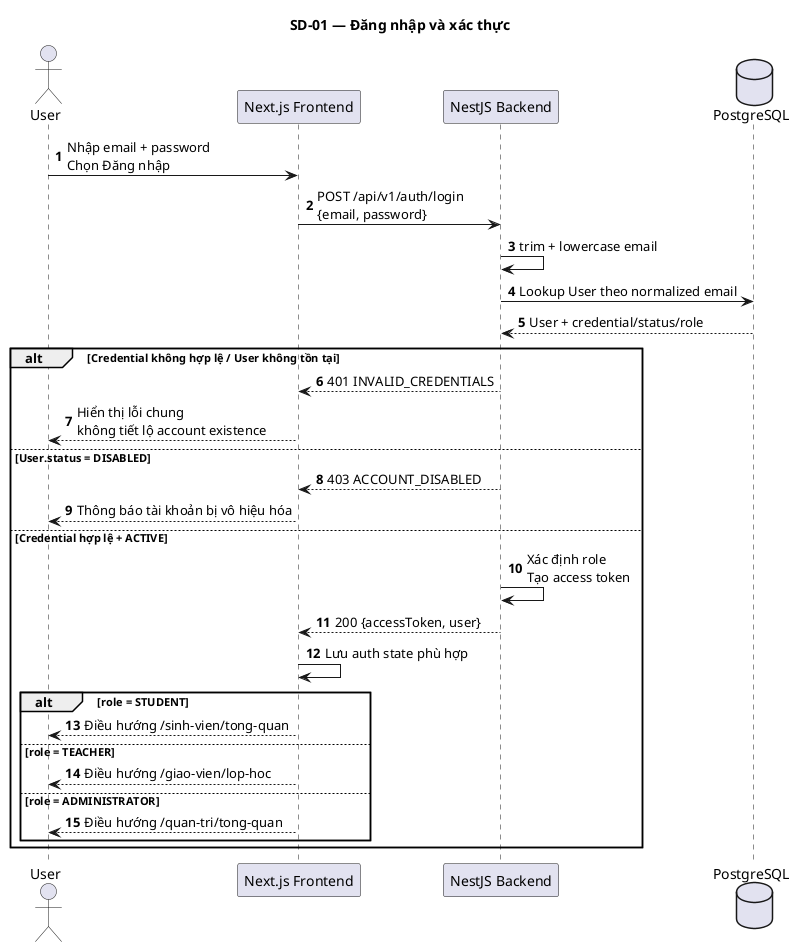
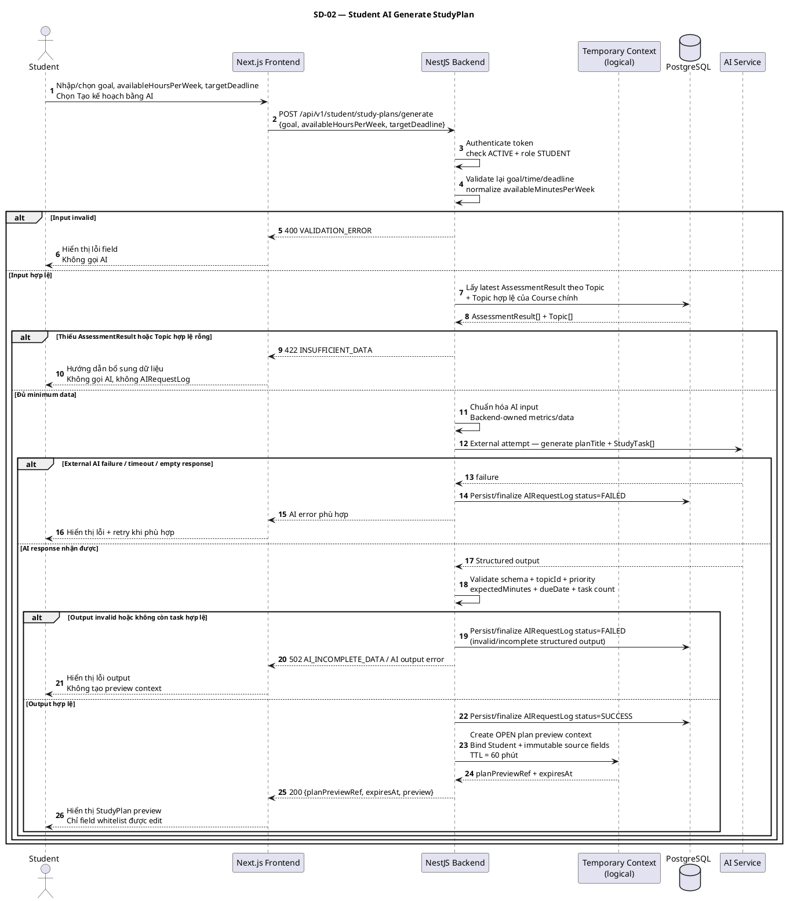
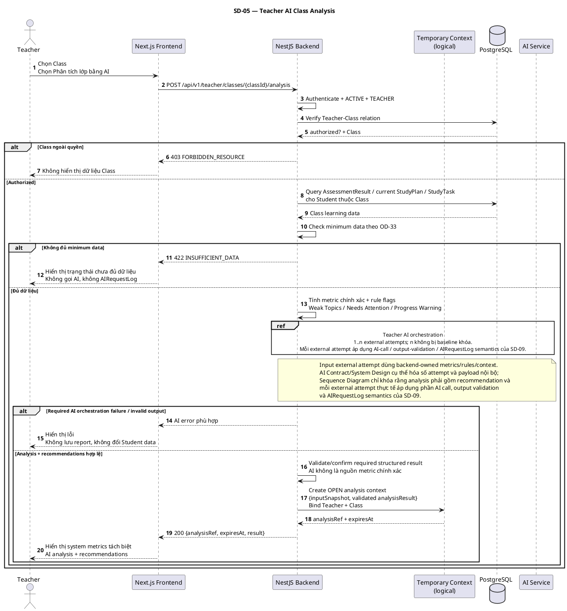
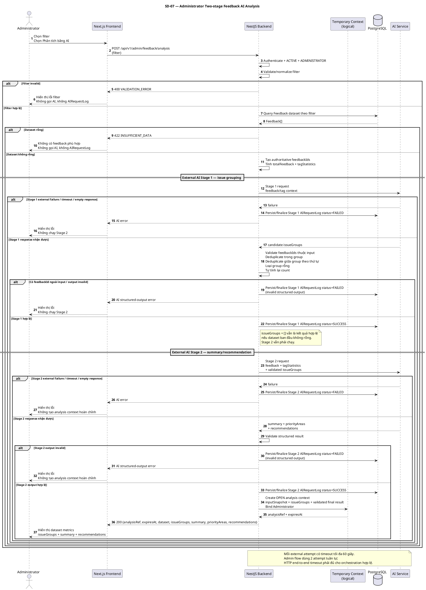
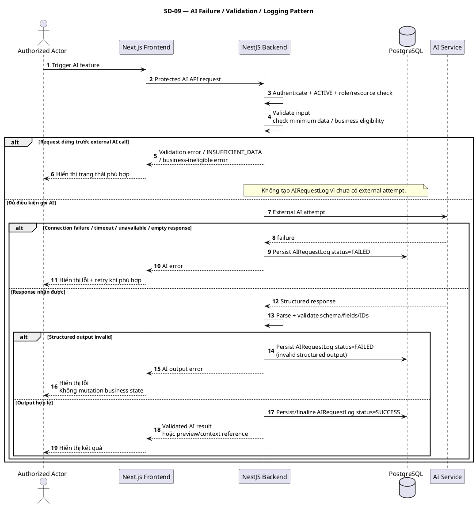

# SEQUENCE DIAGRAM SPECIFICATION
## Hệ thống hỗ trợ tự học ứng dụng AI — Core Flows

**Phiên bản:** 1.0 Baseline Final  
**Ngày:** 22/10/2026  
**Trạng thái:** Baseline Final — Official Release  
**Phạm vi:** Các luồng tương tác quan trọng của MVP — Student, Teacher, Administrator  
**Baseline nguồn:** `DACN-REQ-UC-BL-2026-10-21-R2`  
**Kiến trúc liên quan:** Next.js Frontend → NestJS REST API → PostgreSQL / AI Service  

---

# 1. Mục đích tài liệu

Tài liệu này chuyển Requirements / Use Case / Activity / API baseline hiện hành thành **Sequence Diagram** cho các luồng tương tác quan trọng của hệ thống.

Mục tiêu:

- mô tả thứ tự message giữa Actor, Next.js Frontend, NestJS Backend, PostgreSQL và AI Service;
- làm rõ vị trí authorization, validation, business-rule check, AI orchestration và persistence;
- biểu diễn các nhánh lỗi/nghiệp vụ quan trọng bằng `alt`, `opt`, `loop`;
- làm rõ các luồng preview → user confirmation → mutation;
- làm rõ transaction, deferred Save, idempotency/replay và history snapshot;
- làm đầu vào cho System Design, AI Contract, Backend/Frontend implementation và Test Case;
- không tạo thêm observable business behavior ngoài baseline hiện hành.

Tài liệu này không thay thế API Specification hoặc Use Case Specification. Sequence Diagram chỉ biểu diễn thứ tự tương tác dựa trên các contract đã được chốt.

---

# 2. Nguồn authority

| Mức | Tài liệu | Vai trò |
|---|---|---|
| 1 | `SRS_v1.5_baseline_final.md` | Requirement, data, AI behavior, error semantics |
| 2A | `Business_Rules_v1.3_baseline_rev1.md` | Authorization, validation, calculation, state, AI governance, data integrity |
| 2B | `Use_Case_Diagram_he_thong_ho_tro_tu_hoc_AI_v1.4_baseline_rev1.md` | Actor, system boundary, 27 Use Case, include/extend |
| 3 | `Use_Case_Specification_v1.1_baseline_rev1.md` | Main/alternate/exception flow |
| 4 | `Activity_Diagram_3_AI_Main_Flows_v1.2_baseline_final.md` | Trình tự nghiệp vụ 3 luồng AI chính |
| 5 | `API_Specification_v1.4_baseline_final.md` | Endpoint, DTO, HTTP semantics, context/idempotency |
| UI | `UI_Sitemap_v1.1_baseline.md` + `Wireframe_Screen_Specification_v1.0_baseline_final.md` | Screen context và UI state |
| Governance | `Document_Governance_and_Traceability_Index_v1.1.md` + Freeze Record v1.1 | Authority, traceability, change control |

Nếu Sequence Diagram cần thay đổi hành vi quan sát được đã baseline hóa, thay đổi đó phải đi qua change control thay vì được tự chốt tại tài liệu này.

---

# 3. Phạm vi Sequence Diagram

Tài liệu v1.0 Baseline Final mô hình hóa 9 diagram:

| ID | Tên | Use Case / phạm vi chính | API chính |
|---|---|---|---|
| `SD-01` | Đăng nhập và xác thực | `UC-COM-001` | `API-COM-AUTH-001` |
| `SD-02` | Student — AI Generate StudyPlan | `UC-STU-005` | `API-STU-PLAN-001` |
| `SD-03` | Student — Apply StudyPlan | `UC-STU-006` | `API-STU-PLAN-002` |
| `SD-04` | Student — AI Adjustment | `UC-STU-009` | `API-STU-ADJUST-001`, `API-STU-ADJUST-002` |
| `SD-05` | Teacher — AI Class Analysis | `UC-TEA-005/006` | `API-TEA-ANALYSIS-001` |
| `SD-06` | Teacher — Save Analysis + History | `UC-TEA-007/008` | `API-TEA-REPORT-001`, `API-TEA-HISTORY-001/002` |
| `SD-07` | Admin — Two-stage Feedback AI Analysis | `UC-ADM-004/005` | `API-ADM-ANALYSIS-001` |
| `SD-08` | Admin — Save Analysis + History | `UC-ADM-006/007` | `API-ADM-ANALYSIS-002`, `API-ADM-HISTORY-001/002` |
| `SD-09` | AI Failure / Validation / Logging Pattern | Cross-cutting AI behavior | Áp dụng cho mọi API có external AI call |

## 3.1. Các luồng không có diagram riêng trong v1.0

Các Use Case CRUD/read-only đơn giản như dashboard, xem AssessmentResult, quản lý task, xem profile, gửi feedback hoặc quản lý user không có diagram riêng trong phiên bản này vì thứ tự tương tác đã đủ rõ từ Use Case/API Specification và không có orchestration phức tạp.

`UC-STU-004 — AI phân tích điểm mạnh/yếu` cũng không có diagram riêng trong v1.0. Luồng này dùng cùng pattern AI chung ở `SD-09`; các ranh giới riêng của nó vẫn giữ theo SRS/UCS/Activity Diagram.

---

# 4. Quy ước mô hình hóa

## 4.1. Lifeline chuẩn

| Lifeline | Ý nghĩa |
|---|---|
| Actor | Student, Teacher hoặc Administrator |
| Next.js Frontend | UI, giữ state hiển thị và gửi REST request |
| NestJS Backend | Authentication, authorization, validation, business rules, AI orchestration, transaction orchestration |
| Temporary Context | **Logical component** giữ server-owned preview/analysis context; không khóa cơ chế lưu vật lý |
| PostgreSQL | Dữ liệu nghiệp vụ và `AIRequestLog` |
| AI Service | External AI runtime/model endpoint |

`Temporary Context` không được hiểu mặc định là Redis, PostgreSQL table hay in-memory store. API baseline chỉ khóa semantics `OPEN/CONSUMED`, TTL, binding, replay và idempotency; lựa chọn storage cụ thể thuộc System Design.

## 4.2. Authorization pattern

Với protected endpoint, Backend phải kiểm tra tối thiểu:

1. access token hợp lệ;
2. User tồn tại;
3. `User.status = ACTIVE`;
4. role phù hợp;
5. ownership/resource relation nếu có.

Frontend guard hoặc ẩn menu không thay thế authorization tại Backend.

## 4.3. AI pattern

- validation / minimum-data / business eligibility chạy trước external AI call;
- request dừng trước external AI call → không có `AIRequestLog`;
- mỗi external AI attempt thực tế → phải có `AIRequestLog`;
- trạng thái cuối của `AIRequestLog` chỉ được hoàn thiện sau khi biết external attempt thất bại hoặc AI output đã qua Backend validation;
- invalid/incomplete structured output sau external attempt phải được ghi nhận là failed attempt, không phải success;
- AI output phải qua Backend validation;
- AI không là nguồn chuẩn của score/count/rate/metric Backend có thể tính chính xác;
- AI failure/invalid output không làm thay đổi trạng thái nghiệp vụ cũ;
- timeout tối đa của **mỗi external AI attempt** là 60 giây.

Sequence Diagram chỉ biểu diễn thời điểm **finalize/persist trạng thái cuối** của log; cơ chế tạo record trước call hay create/update sau call là chi tiết triển khai và không bị khóa tại artifact này.

## 4.4. Temporary Context pattern

Các reference hiện hành:

- `planPreviewRef` — StudyPlan preview;
- `adjustmentRef` — StudyPlan adjustment preview;
- `analysisRef` — Teacher/Admin analysis context.

Context ở trạng thái `OPEN` có TTL mặc định 60 phút. Mutation thành công mới chuyển sang `CONSUMED`; retry hợp lệ không được mutation lần hai mà trả replay result.

**Replay retention sau khi `CONSUMED`:**

- `OPEN` context hết hiệu lực theo `expiresAt` (TTL mặc định 60 phút);
- sau mutation thành công, replay mapping/resource identity phải được giữ tối thiểu đến **mốc muộn hơn giữa `expiresAt` và `consumedAt + 10 phút`**;
- trong các mutation diagram, `CONTEXT_INVALID_OR_EXPIRED` chỉ áp dụng khi reference không còn `OPEN` hợp lệ **và** cũng không còn retained replay mapping;
- reference đã `CONSUMED` nhưng replay mapping còn trong retention window vẫn đi vào nhánh `CONSUMED`/replay, kể cả khi `expiresAt` ban đầu đã qua.

**Concurrent claim semantics:**

- Backend phải serialize/atomically claim context `OPEN` để chỉ một request được mutation tại một thời điểm;
- nếu request concurrent khác đang giữ claim, request sau phải **serialize/wait rồi re-resolve state**, không được cùng mutation;
- winner thành công → request còn lại xử lý theo `CONSUMED`/replay; riêng StudyPlan Apply với payload khác trả `409 CONTEXT_ALREADY_CONSUMED`;
- winner rollback/thất bại → context vẫn `OPEN` nếu còn hiệu lực và request hợp lệ tiếp theo mới được claim lại;
- concrete locking/transaction/atomic-claim mechanism thuộc System Design.

---

# 5. SD-01 — Đăng nhập và xác thực

## 5.1. Mục tiêu

Mô tả `UC-COM-001`: user gửi email/password, Backend normalize email, xác thực tài khoản, kiểm tra trạng thái và trả access token + user/role.

## 5.2. PlantUML



## 5.3. Điểm cần giữ

- email lookup dùng giá trị đã `trim + lowercase`;
- sai credential không được leak việc email có tồn tại hay không;
- `DISABLED` không được đăng nhập;
- access token không làm mất yêu cầu kiểm tra `ACTIVE` ở các protected API sau đó.

**Traceability:** `UC-COM-001`, `FR-COM-001`, `BR-039`, `ERR-001`, `ERR-002`, `API-COM-AUTH-001`.

---

# 6. SD-02 — Student AI Generate StudyPlan

## 6.1. Mục tiêu

Mô tả phần Generate của `UC-STU-005`: Student gửi goal/time/deadline, Backend validate lại input, lấy dữ liệu học tập, gọi AI, validate output và tạo `planPreviewRef` server-owned.

## 6.2. PlantUML



## 6.3. Boundary quan trọng

Client chỉ được chỉnh:

- `planTitle`;
- task `title`;
- `expectedMinutes`;
- `dueDate`;
- `priority`.

Client không được đổi `topicId`, task goal hoặc dữ liệu nguồn. Generate thành công **chưa tạo** `StudyPlan/StudyTask` nghiệp vụ.

**Traceability:** `UC-STU-005`, `FR-STU-005`, `BR-001`, `BR-004`, `BR-005`, `BR-021`, `BR-035`, `BR-037`, `DATA-REQ-005/006/007/013`, `API-STU-PLAN-001`, `API-DD-002`.

---

# 7. SD-03 — Student Apply StudyPlan

## 7.1. Mục tiêu

Mô tả `UC-STU-006`: Student xác nhận Apply preview, Backend resolve context, revalidate tại `applyTime`, thực hiện transaction và bảo đảm idempotency/replay.

## 7.2. PlantUML

```plantuml
@startuml

title SD-03 — Student Apply StudyPlan
skinparam shadowing false

autonumber

actor Student as STU
participant "Next.js Frontend" as FE
participant "NestJS Backend" as BE
participant "Temporary Context\n(logical)" as CTX
database "PostgreSQL" as DB

STU -> FE: Chỉnh field được phép\nXác nhận Áp dụng
FE -> BE: POST /api/v1/student/study-plans/apply\n{planPreviewRef, planTitle?, taskEdits?}
BE -> BE: Authenticate + ACTIVE + STUDENT
BE -> CTX: Resolve reference + verify Student binding

alt Retained Context = CONSUMED
    CTX --> BE: replay metadata + requestFingerprint
    BE -> BE: Normalize payload\nSo sánh fingerprint
    alt Fingerprint tương đương
        BE --> FE: 200 replayed=true\nTrả cùng logical result
    else Payload khác lần Apply thành công
        BE --> FE: 409 CONTEXT_ALREADY_CONSUMED
    end
else Context = OPEN và còn hiệu lực
    CTX --> BE: Original validated preview
    BE -> BE: applyTime = now\nMerge whitelist edits\nRevalidate toàn bộ preview

    alt Preview stale / validation fail
        BE --> FE: 400 VALIDATION_ERROR\nhoặc 409 STALE_PREVIEW
        FE --> STU: Yêu cầu sửa/tạo preview mới
    else Preview hợp lệ tại applyTime
        BE -> CTX: Atomic claim OPEN context
        CTX --> BE: claim granted / serialized pending
        note over BE,CTX
          Nếu request concurrent khác đang giữ claim, Backend phải serialize/wait
          rồi re-resolve state: winner success → CONSUMED/replay (hoặc 409 nếu
          StudyPlan Apply payload khác); winner rollback → chỉ claim lại khi context
          vẫn OPEN và còn hiệu lực. Không có hai mutation đồng thời.
        end note

        group Logical atomic mutation + replay state — API-DD-002
            BE -> DB: Archive current ACTIVE/COMPLETED plan nếu có
            BE -> DB: INSERT StudyPlan status=ACTIVE
            BE -> DB: INSERT StudyTask[] status=TODO
            BE -> CTX: Persist requestFingerprint + replay result\nTransition OPEN → CONSUMED
            note over DB,CTX
              Business mutation và replay/context state phải hoàn tất
              như một logical atomic operation: không được tồn tại cửa sổ
              business state đã commit nhưng context vẫn có thể mutation lại,
              hoặc context đã CONSUMED khi business mutation chưa thành công.
              Concrete transaction/locking mechanism thuộc System Design.
            end note
        end

        alt Logical atomic operation failure
            BE -> BE: Roll back logical mutation
            BE -> CTX: Release claim / giữ OPEN nếu chưa hết TTL
            BE --> FE: 500 DATABASE_FAILURE
            FE --> STU: Giữ nguyên trạng thái nghiệp vụ cũ
        else Logical atomic operation success
            BE --> FE: 201 replayed=false\n{plan, tasks}
            FE --> STU: Hiển thị current StudyPlan mới
        end
    end
else Reference invalid / hết OPEN TTL
và không còn retained replay mapping
    CTX --> BE: invalid/expired
    BE --> FE: 409 CONTEXT_INVALID_OR_EXPIRED
end

@enduml
```

## 7.3. Boundary quan trọng

- Apply phải revalidate tại thời điểm thực tế, không tin preview cũ vẫn hợp lệ;
- chỉ bắt đầu DB mutation sau khi revalidation thành công;
- archive plan cũ + create plan + create tasks + replay/context state phải nằm trong cùng logical atomic operation theo `API-DD-002`;
- logical atomic operation thất bại không consume context;
- retry cùng payload sau thành công trả replay, không tạo plan thứ hai;
- retained replay mapping phải được giữ đến `max(expiresAt, consumedAt + 10 phút)`; request concurrent phải serialize/re-resolve theo API-DD-002;
- Student Reject preview không cần mutation API; context tự hết TTL.

**Traceability:** `UC-STU-006`, `FR-STU-005/006`, `BR-005`, `BR-021`, `BR-024`, `BR-025`, `BR-037`, `DATA-REQ-005/006/013`, `DB-REQ-002`, `API-STU-PLAN-002`, `API-DD-002`.

---

# 8. SD-04 — Student AI Adjustment

## 8.1. Mục tiêu

Mô tả end-to-end `UC-STU-009`: kiểm tra eligibility, tạo adjustment preview, Student Accept/Reject, revalidate và transaction update task.

## 8.2. PlantUML

```plantuml
@startuml

title SD-04 — Student AI Adjustment
skinparam shadowing false

autonumber

actor Student as STU
participant "Next.js Frontend" as FE
participant "NestJS Backend" as BE
participant "Temporary Context\n(logical)" as CTX
database "PostgreSQL" as DB
participant "AI Service" as AI

STU -> FE: Chọn Điều chỉnh bằng AI
FE -> BE: POST /api/v1/student/study-plan-adjustments/generate
BE -> BE: Authenticate + ACTIVE + STUDENT
BE -> DB: Lấy current StudyPlan + TODO tasks\n+ goal/availability + progress metrics
DB --> BE: Current plan data
BE -> BE: Check eligibility

alt Không có current plan
    BE --> FE: 422 NO_CURRENT_PLAN
    FE --> STU: Hướng tạo StudyPlan trước\nKhông gọi AI, không AIRequestLog
else now > endDate
    BE --> FE: 422 PLAN_PAST_DEADLINE
    FE --> STU: Hướng tạo plan mới\nKhông gọi AI, không AIRequestLog
else Không còn TODO task
    BE --> FE: 422 NO_TODO_TASKS
    FE --> STU: Thông báo không còn task cần điều chỉnh\nKhông gọi AI, không AIRequestLog
else Eligible
    BE -> BE: Chuẩn hóa input\nChỉ task TODO
    BE -> AI: External attempt — đề xuất adjustment

    alt External AI failure / timeout / empty response
        AI --> BE: failure
        BE -> DB: Persist/finalize AIRequestLog status=FAILED
        BE --> FE: AI error
        FE --> STU: Hiển thị lỗi, giữ nguyên plan/tasks
    else AI response nhận được
        AI --> BE: Structured adjustment
        BE -> BE: Validate taskId/status + expectedMinutes\n+ dueDate + priority

        alt Output invalid
            BE -> DB: Persist/finalize AIRequestLog status=FAILED\n(invalid structured output)
            BE --> FE: AI output error
            FE --> STU: Hiển thị lỗi, giữ nguyên plan/tasks
        else Output hợp lệ
            BE -> DB: Persist/finalize AIRequestLog status=SUCCESS
            BE -> CTX: Create OPEN adjustment context\nBind Student + current plan
            CTX --> BE: adjustmentRef + expiresAt
            BE --> FE: 200 {adjustmentRef, expiresAt, preview}
            FE --> STU: Hiển thị adjustment preview

            alt Student Reject
                STU -> FE: Từ chối
                FE --> STU: Giữ nguyên task\nKhông gọi mutation API
            else Student Accept
                STU -> FE: Chấp nhận
                FE -> BE: POST /api/v1/student/study-plan-adjustments/apply\n{adjustmentRef}
                BE -> BE: Authenticate + ACTIVE + STUDENT
                BE -> CTX: Resolve + verify binding/state

                alt Retained Context = CONSUMED
                    BE --> FE: 200 replayed=true\nKhông update lần hai
                else Context = OPEN và còn hiệu lực
                    BE -> DB: Re-read current plan + target tasks
                    DB --> BE: Current state
                    BE -> BE: Revalidate current plan/endDate\nall target tasks vẫn TODO\nfields vẫn hợp lệ

                    alt Stale preview
                        BE --> FE: 409 STALE_PREVIEW
                    else Revalidation pass
                        BE -> CTX: Atomic claim OPEN context
                        CTX --> BE: claim granted / serialized pending
                        note over BE,CTX
                          Concurrent request phải serialize/wait rồi re-resolve state.
                          Winner success → replay; winner rollback → chỉ claim lại nếu
                          context vẫn OPEN và còn hiệu lực.
                        end note
                        group Logical atomic mutation + replay state — API-DD-002
                            BE -> DB: UPDATE toàn bộ target TODO tasks\nexpectedMinutes/dueDate/priority
                            BE -> BE: Tính lại progress theo state sau update
                            BE -> CTX: Persist replay result\nTransition OPEN → CONSUMED
                            note over DB,CTX
                              Toàn bộ adjustment set và replay/context state phải
                              hoàn tất như một logical atomic operation. Không được
                              để partial task update hoặc cửa sổ retry mutation lần hai.
                              Concrete transaction/locking mechanism thuộc System Design.
                            end note
                        end

                        alt Logical atomic operation failure
                            BE -> BE: Roll back toàn bộ validated adjustment set
                            BE -> CTX: Release claim / giữ OPEN nếu hợp lệ
                            BE --> FE: 500 DATABASE_FAILURE
                        else Logical atomic operation success
                            BE --> FE: 200 replayed=false\n{updatedTasks, progress}
                            FE --> STU: Hiển thị task/progress mới
                        end
                    end
                else Reference invalid / hết OPEN TTL
                và không còn retained replay mapping
                    BE --> FE: 409 CONTEXT_INVALID_OR_EXPIRED
                end
            end
        end
    end
end

@enduml
```

## 8.3. Boundary quan trọng

- ba trường hợp `NO_CURRENT_PLAN`, `PLAN_PAST_DEADLINE`, `NO_TODO_TASKS` là **business ineligible**, không phải `INSUFFICIENT_DATA`;
- AI chỉ đề xuất `expectedMinutes`, `dueDate`, `priority` cho task `TODO`;
- MVP không partial accept;
- toàn bộ adjustment set + replay/context state phải hoàn tất như một logical atomic operation; concrete transaction mechanism thuộc System Design;
- stale preview không update task nào;
- retained replay mapping phải được giữ đến `max(expiresAt, consumedAt + 10 phút)`; concurrent Apply phải serialize/re-resolve trước khi mutation.

**Traceability:** `UC-STU-009`, `FR-STU-009`, `BR-006`, `BR-028`, `BR-035`, `BR-036`, `OD-40`, `DB-REQ-002`, `API-STU-ADJUST-001`, `API-STU-ADJUST-002`, `API-DD-002`.

---

# 9. SD-05 — Teacher AI Class Analysis

## 9.1. Mục tiêu

Mô tả `UC-TEA-005 <<include>> UC-TEA-006`: Teacher yêu cầu phân tích Class, Backend kiểm tra Teacher–Class, tính metric/rule, gọi AI và tạo `analysisRef`.

## 9.2. PlantUML



## 9.3. Boundary quan trọng

- Backend kiểm tra Teacher–Class trước khi trả/phân tích dữ liệu;
- minimum data thỏa khi có AssessmentResult hợp lệ **hoặc** có Student với current StudyPlan chứa ít nhất một StudyTask;
- Backend tính metric/rule chính xác;
- `UC-TEA-006` luôn nằm trong mục tiêu của `UC-TEA-005`;
- Sequence Diagram **không khóa** Teacher thành một hay nhiều external AI requests;
- mỗi attempt thực tế đều phải log;
- analysis context giữ đúng snapshot/result của analysis-time.

**Traceability:** `UC-TEA-005`, `UC-TEA-006`, `FR-TEA-004/005/006`, `BR-002`, `BR-004`, `BR-007`, `BR-009`, `BR-010`, `BR-011`, `BR-018`, `BR-026`, `BR-035`, `OD-33`, `API-TEA-ANALYSIS-001`, `API-DD-002`.

---

# 10. SD-06 — Teacher Save Analysis + History

## 10.1. Mục tiêu

Mô tả deferred Save của `UC-TEA-007` và history read-only của `UC-TEA-008`.

## 10.2. PlantUML

```plantuml
@startuml

title SD-06 — Teacher Save Analysis + History
skinparam shadowing false

autonumber

actor Teacher as TEA
participant "Next.js Frontend" as FE
participant "NestJS Backend" as BE
participant "Temporary Context\n(logical)" as CTX
database "PostgreSQL" as DB
participant "AI Service" as AI

== Save validated analysis ==
TEA -> FE: Chọn Lưu sau analysis thành công
FE -> BE: POST /api/v1/teacher/classes/{classId}/analysis-reports\n{analysisRef}
BE -> BE: Authenticate + ACTIVE + TEACHER
BE -> DB: Recheck Teacher-Class relation
DB --> BE: authorized?

alt Không có quyền Class
    BE --> FE: 403 FORBIDDEN_RESOURCE
else Authorized
    BE -> CTX: Resolve analysisRef\nverify Teacher + Class binding

    alt Retained Context = CONSUMED
        CTX --> BE: Saved replay result
        BE --> FE: 200 replayed=true\nCùng report identity
    else Context = OPEN và còn hiệu lực
        CTX --> BE: inputSnapshot + validated analysisResult
        BE -> CTX: Atomic claim OPEN context\nSerialize concurrent Save cho cùng reference
        CTX --> BE: claim granted / serialized pending
        note over BE,CTX
          Nếu concurrent Save đang giữ claim, request sau phải serialize/wait và
          re-resolve: winner success → replay cùng report identity; winner rollback →
          chỉ claim lại nếu context vẫn OPEN và còn hiệu lực.
        end note
        group Logical atomic save + replay state — API-DD-002
            BE -> DB: INSERT ClassAnalysisReport\n(inputSnapshot JSONB, analysisResult JSONB)
            DB --> BE: reportId + createdAt
            BE -> CTX: Persist replay result/report identity\nTransition OPEN → CONSUMED
            note over DB,CTX
              Report persistence và replay/context state phải hoàn tất
              như một logical atomic operation. Không được có cửa sổ
              report đã commit nhưng analysisRef vẫn có thể Save lần hai.
              Concrete mechanism thuộc System Design.
            end note
        end

        alt Logical atomic save failure
            BE -> BE: Roll back/compensate logical save
            BE -> CTX: Release claim / giữ OPEN nếu context còn hợp lệ
            BE --> FE: 500 DATABASE_FAILURE
        else Logical atomic save success
            BE --> FE: 201 replayed=false\n{id, classId, createdAt}
            FE --> TEA: Hiển thị Save success
        end
    else Reference invalid / hết OPEN TTL
    và không còn retained replay mapping
        BE --> FE: 409 CONTEXT_INVALID_OR_EXPIRED
    end
end

== Read history later ==
TEA -> FE: Mở Lịch sử phân tích
FE -> BE: GET /api/v1/teacher/classes/{classId}/analysis-reports?page=1&limit=20
BE -> BE: Authenticate + ACTIVE + TEACHER
BE -> DB: Verify Teacher-Class + query stored reports\nORDER BY createdAt DESC
DB --> BE: Stored report summaries
BE --> FE: 200 {items, meta}
FE --> TEA: Hiển thị danh sách history

TEA -> FE: Mở reportId
FE -> BE: GET /api/v1/teacher/classes/{classId}/analysis-reports/{reportId}
BE -> BE: Authenticate + ACTIVE + TEACHER
BE -> DB: Verify Class ownership + read stored report
DB --> BE: inputSnapshot + analysisResult + createdAt
BE --> FE: 200 stored snapshot/result
FE --> TEA: Hiển thị read-only detail

note over BE,AI
  History không gọi AI,
  không recompute từ Class live,
  không tạo AIRequestLog.
end note

@enduml
```

## 10.3. Boundary quan trọng

- client Save chỉ gửi `analysisRef`, không gửi snapshot/result làm nguồn chuẩn;
- Backend không thay snapshot analysis-time bằng dữ liệu Class live lúc Save;
- Save phải atomic-claim/serialize `analysisRef` đang `OPEN` trước persistence để ngăn hai request concurrent cùng tạo report;
- report persistence + replay result + `OPEN → CONSUMED` phải hoàn tất như một logical atomic operation, không được có commit window gây duplicate;
- nếu logical atomic save fail thì release claim và giữ context `OPEN` nếu chưa hết hạn;
- retry Save thành công không tạo report thứ hai;
- retained replay mapping phải được giữ đến `max(expiresAt, consumedAt + 10 phút)`; concurrent Save phải serialize/re-resolve theo API-DD-002;
- history list/detail đều re-authenticate protected request và chỉ đọc record đã lưu;
- history không AI call, không recompute live, không edit/delete/rerun.

**Traceability:** `UC-TEA-007`, `UC-TEA-008`, `FR-TEA-007/008`, `BR-030`, `BR-031`, `BR-044`, `BR-045`, `OD-44`, `OD-45`, `DATA-REQ-015`, `API-TEA-REPORT-001`, `API-TEA-HISTORY-001/002`, `API-DD-002`.

---

# 11. SD-07 — Administrator Two-stage Feedback AI Analysis

## 11.1. Mục tiêu

Mô tả bắt buộc two-stage orchestration của quan hệ `UC-ADM-005 <<include>> UC-ADM-004`: Stage 1 grouping → Backend validation/deduplicate/count → Stage 2 summary/recommendation → `analysisRef`.

## 11.2. PlantUML



## 11.3. Boundary quan trọng

- frontend gửi filter, không gửi `feedbackIds` tùy ý làm nguồn chuẩn;
- Backend tạo authoritative dataset và tag statistics;
- Stage 1 và Stage 2 là **hai external attempts bắt buộc** trong full successful flow;
- validation/deduplication nằm giữa hai stage;
- cùng `feedbackId` chỉ được tính vào tối đa một issueGroup;
- `count` luôn do Backend tính lại;
- `issueGroups = []` sau valid Stage 1 không chặn Stage 2;
- Stage 1 fail → không Stage 2;
- full success tối thiểu có 2 `AIRequestLog`.

**Traceability:** `UC-ADM-004`, `UC-ADM-005`, `FR-ADM-004/005`, `BR-004`, `BR-008`, `BR-009`, `BR-010`, `BR-011`, `BR-013`, `BR-014`, `BR-015`, `BR-035`, `BR-042`, `BR-043`, `OD-34`, `OD-42`, `OD-43`, `AI-REQ-024`, `API-ADM-ANALYSIS-001`, `API-DD-002`, `API-DD-003`.

---

# 12. SD-08 — Administrator Save Analysis + History

## 12.1. Mục tiêu

Mô tả deferred Save của `UC-ADM-006` và history snapshot của `UC-ADM-007`.

## 12.2. PlantUML

```plantuml
@startuml

title SD-08 — Administrator Save Analysis + History
skinparam shadowing false

autonumber

actor Administrator as ADM
participant "Next.js Frontend" as FE
participant "NestJS Backend" as BE
participant "Temporary Context\n(logical)" as CTX
database "PostgreSQL" as DB
participant "AI Service" as AI

== Save completed two-stage analysis ==
ADM -> FE: Chọn Lưu
FE -> BE: POST /api/v1/admin/feedback/analyses\n{analysisRef}
BE -> BE: Authenticate + ACTIVE + ADMINISTRATOR
BE -> CTX: Resolve analysisRef + verify binding

alt Retained Context = CONSUMED
    CTX --> BE: Saved replay result
    BE --> FE: 200 replayed=true\nCùng FeedbackAnalysis identity
else Context = OPEN và còn hiệu lực
    CTX --> BE: inputSnapshot + validated analysisResult
    BE -> CTX: Atomic claim OPEN context\nSerialize concurrent Save cho cùng reference
    CTX --> BE: claim granted / serialized pending
    note over BE,CTX
      Nếu concurrent Save đang giữ claim, request sau phải serialize/wait và
      re-resolve: winner success → replay cùng analysis identity; winner rollback →
      chỉ claim lại nếu context vẫn OPEN và còn hiệu lực.
    end note
    group Logical atomic save + replay state — API-DD-002
        BE -> DB: INSERT FeedbackAnalysis\ninputSnapshot JSONB + analysisResult JSONB
        DB --> BE: analysisId + createdAt
        BE -> CTX: Persist replay result/analysis identity\nTransition OPEN → CONSUMED
        note over DB,CTX
          FeedbackAnalysis persistence và replay/context state phải hoàn tất
          như một logical atomic operation. Không được có cửa sổ record đã commit
          nhưng analysisRef vẫn có thể Save lần hai. Concrete mechanism thuộc System Design.
        end note
    end

    alt Logical atomic save failure
        BE -> BE: Roll back/compensate logical save
        BE -> CTX: Release claim / giữ OPEN nếu context còn hợp lệ
        BE --> FE: 500 DATABASE_FAILURE
    else Logical atomic save success
        BE --> FE: 201 replayed=false\n{id, createdAt}
        FE --> ADM: Hiển thị Save success
    end
else Reference invalid / hết OPEN TTL
và không còn retained replay mapping
    BE --> FE: 409 CONTEXT_INVALID_OR_EXPIRED
end

== Read history later ==
ADM -> FE: Mở lịch sử phân tích feedback
FE -> BE: GET /api/v1/admin/feedback/analyses?page=1&limit=20
BE -> BE: Authenticate + ACTIVE + ADMINISTRATOR
BE -> DB: Query stored FeedbackAnalysis\nORDER BY createdAt DESC
DB --> BE: Stored analysis summaries
BE --> FE: 200 {items, meta}
FE --> ADM: Hiển thị history

ADM -> FE: Mở analysisId
FE -> BE: GET /api/v1/admin/feedback/analyses/{analysisId}
BE -> BE: Authenticate + ACTIVE + ADMINISTRATOR
BE -> DB: Read stored FeedbackAnalysis
DB --> BE: inputSnapshot + analysisResult + createdAt
BE --> FE: 200 stored snapshot/result
FE --> ADM: Hiển thị read-only detail

note over BE,AI
  History không gọi AI,
  không thay snapshot bằng Feedback live,
  không tạo AIRequestLog.
end note

@enduml
```

## 12.3. Boundary quan trọng

- `analysisRef` phải trỏ tới đúng completed two-stage analysis context;
- client không gửi snapshot/result làm nguồn chuẩn;
- `inputSnapshot` tối thiểu gồm filter, feedbackIds, totalFeedback, tagStatistics;
- `analysisResult` gồm issueGroups, summary, priorityAreas, recommendations;
- Save phải atomic-claim/serialize `analysisRef` đang `OPEN` trước persistence để ngăn duplicate khi request concurrent;
- FeedbackAnalysis persistence + replay result + `OPEN → CONSUMED` phải hoàn tất như một logical atomic operation, không được có commit window gây duplicate;
- nếu logical atomic save fail thì release claim và giữ context `OPEN` nếu chưa hết hạn;
- retry Save không tạo `FeedbackAnalysis` thứ hai;
- retained replay mapping phải được giữ đến `max(expiresAt, consumedAt + 10 phút)`; concurrent Save phải serialize/re-resolve theo API-DD-002;
- history list/detail đều là protected request và chỉ đọc snapshot đã lưu, không dựa vào Feedback live hiện tại.

**Traceability:** `UC-ADM-006`, `UC-ADM-007`, `FR-ADM-006/007`, `BR-030`, `BR-031`, `BR-044`, `BR-046`, `OD-44`, `OD-46`, `DATA-REQ-015`, `API-ADM-ANALYSIS-002`, `API-ADM-HISTORY-001/002`, `API-DD-002`.

---

# 13. SD-09 — AI Failure / Validation / Logging Pattern dùng chung

## 13.1. Mục tiêu

Diagram này là pattern xuyên suốt cho mọi endpoint thực sự gọi external AI. Nó làm rõ ranh giới giữa lỗi trước AI call và lỗi sau khi external attempt đã bắt đầu.

## 13.2. PlantUML



## 13.3. Quy tắc tổng quát

| Tình huống | External AI call | `AIRequestLog` | Business mutation |
|---|:---:|:---:|:---:|
| Input validation fail | Không | Không | Không |
| `INSUFFICIENT_DATA` | Không | Không | Không |
| Business ineligible | Không | Không | Không |
| Connection/timeout/provider failure sau attempt | Có | Failed log | Không |
| Empty/invalid structured output sau attempt | Có | Failed log | Không |
| Valid output | Có | Success log | Chỉ xảy ra ở bước user-confirmed mutation nếu flow yêu cầu |

**Traceability:** `FR-COM-005`, `FR-COM-006`, `BR-004`, `BR-009`, `BR-010`, `BR-011`, `BR-035`, `AI-REQ-018`, API section 3.8.

---

# 14. Traceability Matrix

| Sequence ID | Use Case | API | Screen chính | Business/Decision anchors chính |
|---|---|---|---|---|
| `SD-01` | `UC-COM-001` | `API-COM-AUTH-001` | `SCR-COM-001` | `BR-039`, `ERR-001/002` |
| `SD-02` | `UC-STU-005` | `API-STU-PLAN-001` | `SCR-STU-005` | `BR-005`, `BR-021`, `BR-035`, `BR-037`, `DATA-REQ-005/006/007/013`, `API-DD-002` |
| `SD-03` | `UC-STU-006` | `API-STU-PLAN-002` | `SCR-STU-005` | `BR-024/025`, `DATA-REQ-005/006/013`, `DB-REQ-002`, `API-DD-002` |
| `SD-04` | `UC-STU-009` | `API-STU-ADJUST-001`, `API-STU-ADJUST-002` | `SCR-STU-008` | `BR-006`, `BR-028`, `OD-40`, `DB-REQ-002`, `API-DD-002` |
| `SD-05` | `UC-TEA-005/006` | `API-TEA-ANALYSIS-001` | `SCR-TEA-005` | `BR-002`, `BR-007`, `BR-010/011`, `BR-018`, `BR-026`, `OD-33`, `API-DD-002` |
| `SD-06` | `UC-TEA-007/008` | `API-TEA-REPORT-001`, `API-TEA-HISTORY-001/002` | `SCR-TEA-005/006` | `BR-030/031`, `BR-044/045`, `OD-44/45`, `DATA-REQ-015`, `API-DD-002` |
| `SD-07` | `UC-ADM-004/005` | `API-ADM-ANALYSIS-001` | `SCR-ADM-004` | `BR-010/011`, `BR-013/014/015`, `BR-042/043`, `OD-34`, `OD-42/43`, `API-DD-002`, `API-DD-003` |
| `SD-08` | `UC-ADM-006/007` | `API-ADM-ANALYSIS-002`, `API-ADM-HISTORY-001/002` | `SCR-ADM-004/005` | `BR-030/031`, `BR-044/046`, `OD-44/46`, `DATA-REQ-015`, `API-DD-002` |
| `SD-09` | Cross-cutting AI UCs | Cross-cutting | Các AI screens | `FR-COM-005/006`, `BR-010/035`, `AI-REQ-018` |

---

# 15. Cross-document consistency checks

## 15.1. Student

- Generate và Apply được tách thành hai interaction flow đúng `UC-STU-005` / `UC-STU-006`.
- Generate không tạo StudyPlan nghiệp vụ; Apply mới mutation database.
- Apply revalidate tại `applyTime` và dùng transaction.
- `UC-STU-009` độc lập với `UC-STU-008` và chỉ sửa field whitelist của task `TODO`.
- Business ineligible của adjustment không bị gộp thành `INSUFFICIENT_DATA`.

## 15.2. Teacher

- Không tạo `UC-TEA-004` mới; FR-TEA-004 là xử lý Backend trong analysis/dashboard.
- `UC-TEA-005` luôn có recommendation của `UC-TEA-006`.
- Không khóa số external AI attempts của Teacher.
- Save dùng backend-owned `analysisRef`.
- History read-only, snapshot-based, không gọi AI.

## 15.3. Administrator

- Admin AI dùng đúng two-stage external inference.
- Backend validation/deduplication/count nằm giữa Stage 1 và Stage 2.
- `issueGroups = []` trên dataset không rỗng vẫn đi Stage 2.
- Save dùng backend-owned `analysisRef` sau flow hoàn chỉnh.
- History snapshot-based, không lấy Feedback live để thay thế.

## 15.4. Cross-cutting

- Protected flow giữ backend authorization.
- Pre-AI rejection không tạo `AIRequestLog`.
- External attempt thực tế phải có log.
- AI output luôn qua Backend validation.
- AI failure không làm thay đổi business state cũ.
- Context replay/idempotency ngăn double mutation khi retry/double-click/network retry.

---

# 16. Các quyết định cố ý chưa khóa ở Sequence Diagram v1.0 Baseline Final

Tài liệu này **không tự quyết định** các nội dung sau:

1. Temporary Context lưu bằng Redis, PostgreSQL, in-memory hay cơ chế khác.
2. Concrete transaction/locking/atomic-claim implementation để bảo đảm business mutation + replay/context state là một logical atomic operation (`OPEN → CONSUMED`).
3. Storage/cleanup strategy cho retained replay mapping, nhưng phải giữ tối thiểu đến `max(expiresAt, consumedAt + 10 phút)`.
4. Số external AI requests của Teacher analysis.
5. Model AI cụ thể, prompt template, schema nội bộ NestJS ↔ AI Runtime.
6. Internal NestJS class/service method name.
7. Repository/ORM implementation cụ thể.
8. Async job/queue — MVP API hiện hành vẫn synchronous; không tự chuyển sang polling/job flow.

Các nội dung trên phải được chốt ở System Design / AI Contract hoặc change control phù hợp nếu cần.

---

# 17. Gợi ý artifact tiếp theo

Sau khi Sequence Diagram v1.0 được phát hành Baseline Final, thứ tự downstream phù hợp là:

1. **System Design / Backend Module Design** — cụ thể hóa service boundary, transaction và Temporary Context implementation;
2. **AI Contract Specification** — schema NestJS ↔ AI Runtime cho Student, Teacher và Admin Stage 1/2;
3. **Database Design / ERD refinement** nếu cần khóa persistence chi tiết;
4. **Test Case Specification** — chuyển các nhánh `alt`/`opt` của Sequence Diagram thành test scenarios;
5. **Implementation backlog** — chia endpoint/service/component theo dependency.

---

# 18. Lịch sử phiên bản

| Version | Date | Nội dung |
|---|---|---|
| 1.0 Draft | 22/10/2026 | Khởi tạo 9 Sequence Diagram core flows từ Requirements/Use Case/Activity/API baseline R2 |
| 1.0 Draft Rev.1 | 22/10/2026 | Self-review corrections: atomic claim Teacher/Admin Save; finalize `AIRequestLog` sau validation; re-auth Adjustment Apply/history detail; trả `expiresAt`; làm rõ Teacher orchestration không phải retry loop |
| 1.0 Draft Rev.2 | 22/10/2026 | Pre-baseline review corrections: mô hình hóa logical atomic mutation/save + replay state theo `API-DD-002`; dùng UML `ref` cho Teacher AI orchestration; bổ sung traceability anchors còn thiếu |
| 1.0 Draft Rev.3 | 22/10/2026 | Pre-baseline corrections: bổ sung replay retention `max(expiresAt, consumedAt + 10 phút)`; làm rõ concurrent claim serialize/re-resolve; thu hẹp SD-05 chỉ tham chiếu AI call/output validation/AIRequestLog semantics của SD-09 |
| 1.0 Baseline Final | 22/10/2026 | Official release: cleanup metadata/version wording; hoàn thiện `API-DD-002` traceability cho các flow tạo Temporary Context; giữ nguyên 9 diagram và observable behavior theo baseline R2 |

