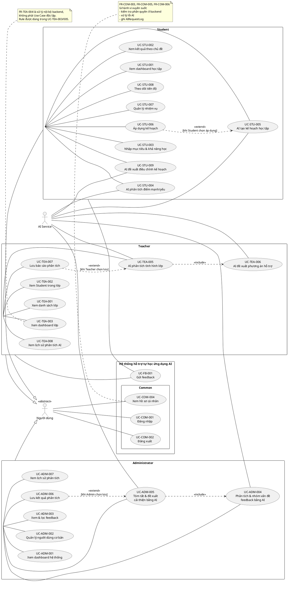
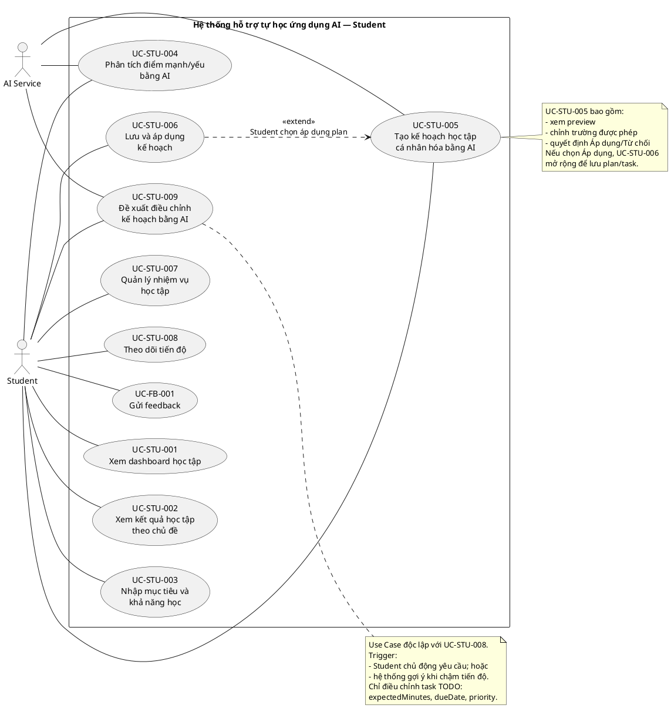
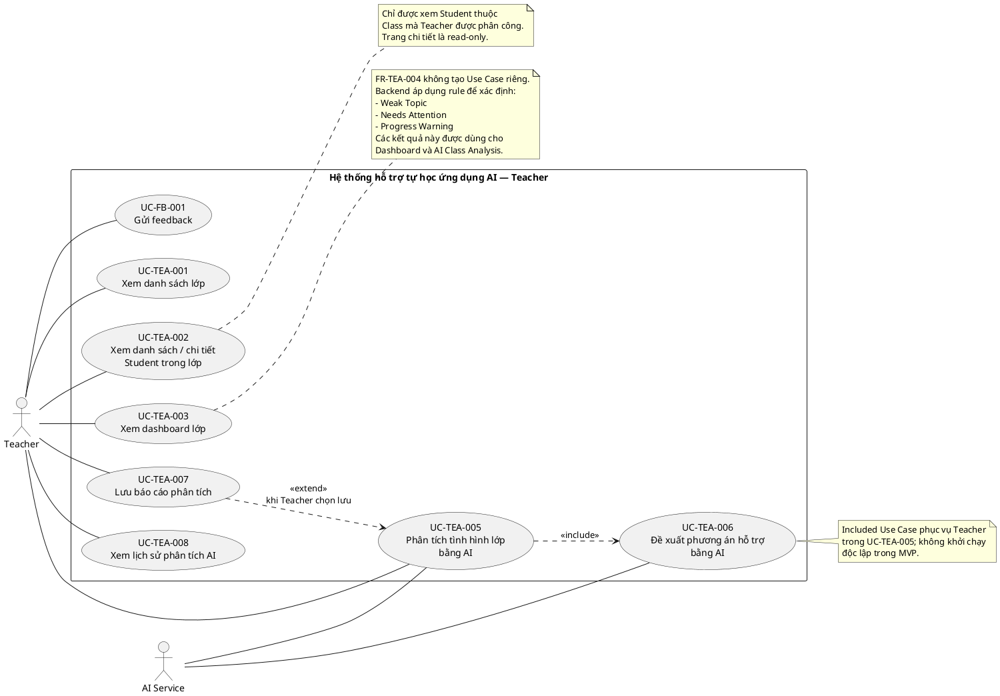
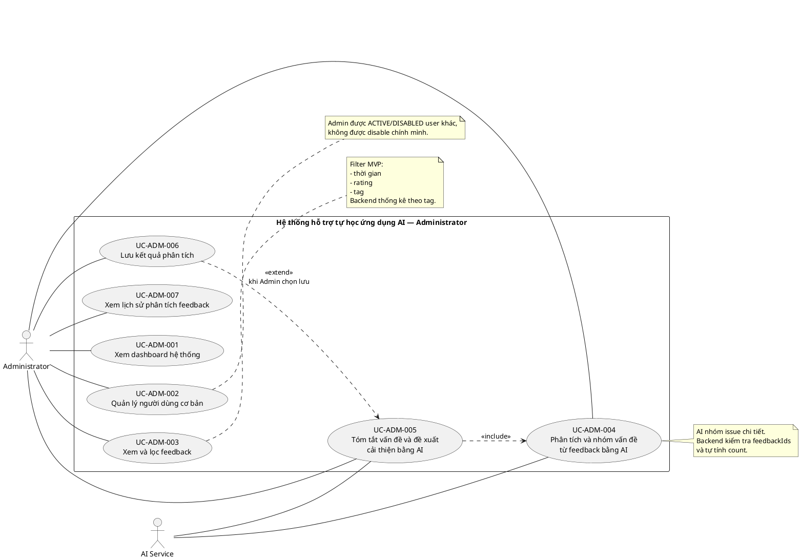

# USE CASE DIAGRAM
## Hệ thống hỗ trợ tự học ứng dụng AI

**Phiên bản:** 1.4 Baseline Rev.1  
**Ngày:** 21/10/2026  
**Nguồn yêu cầu:** `SRS_v1.5_baseline_final.md`  
**Phạm vi:** MVP phục vụ đồ án chuyên ngành

---

# 1. Mục đích tài liệu

Tài liệu này chuyển các yêu cầu chức năng trong SRS v1.5 Baseline thành mô hình Use Case ở mức hệ thống.

Mục tiêu:

- xác định actor tương tác với hệ thống;
- xác định các mục tiêu nghiệp vụ chính của từng actor;
- thể hiện quan hệ `<<include>>`, `<<extend>>` khi có ý nghĩa;
- giữ khả năng truy vết từ `FR-*` sang `UC-*`;
- làm nền cho Use Case Specification, Activity Diagram, Sequence Diagram, API, UI và Test Case.

Tài liệu **không mở rộng phạm vi chức năng ngoài SRS**.

## 1.1. Thay đổi chính ở phiên bản 1.2 Baseline

Phiên bản 1.2 giữ các chỉnh sửa đúng của v1.1 và siết thêm ranh giới/truy vết Use Case:

- tiếp tục **không tạo `UC-TEA-004`** vì `FR-TEA-004` có actor là **Hệ thống** và là xử lý nội bộ backend;
- tiếp tục truy vết `FR-TEA-004` vào `UC-TEA-003` và `UC-TEA-005`;
- tiếp tục giữ `UC-STU-009` độc lập với `UC-STU-008`;
- sửa ranh giới `UC-STU-005`: Use Case này bao gồm bước Student xem preview, chỉnh các trường được phép và đưa ra quyết định **Áp dụng/Từ chối**; nếu chọn **Áp dụng**, `UC-STU-006` mở rộng để backend lưu StudyPlan/StudyTask;
- đánh dấu actor tổng quát `Người dùng` là `<<abstract>>` trên sơ đồ tổng quan;
- làm rõ `UC-TEA-006` là included Use Case phục vụ mục tiêu của Teacher trong `UC-TEA-005`, không phải chức năng Teacher phải khởi chạy độc lập;
- đổi cách gọi “25 Use Case actor-facing” thành **“25 Use Case được mô hình hóa”**;
- chi tiết hóa traceability cho `FR-COM-003`, `FR-COM-005` và `FR-COM-006` để thuận lợi cho Use Case Specification và Test Case.

## 1.2. Đồng bộ ở phiên bản 1.3 Baseline

Phiên bản 1.3 **không thay đổi system boundary, actor hoặc số lượng 25 Use Case**. Bản này đồng bộ nguồn lên SRS v1.4 Baseline và Business Rules v1.2 Baseline:

- `UC-STU-004` vẫn là một Use Case; OD-41 chỉ làm rõ `goal` là optional context, không tạo UC mới;
- `UC-ADM-005 <<include>> UC-ADM-004` giữ nguyên. OD-42 chốt cách triển khai nghiệp vụ thành two-stage external AI inference nhưng **không thay đổi quan hệ UML**;
- OD-43 làm rõ `issueGroups = []` là một kết quả hợp lệ của UC-ADM-004 trên dataset không rỗng; không tạo alternate Use Case mới;
- OD-44 làm rõ deferred Save của `UC-TEA-007` và `UC-ADM-006` dùng backend-controlled analysis reference; đây là data-integrity behavior bên trong Use Case, không phải actor/use case mới.

---

## 1.3. Đồng bộ ở phiên bản 1.4 Baseline

Phiên bản 1.4 thực hiện CR-001 và thay đổi danh mục Use Case từ **25 lên 27**:

- thêm `UC-TEA-008 — Xem lịch sử phân tích AI của lớp` từ `FR-TEA-008`;
- thêm `UC-ADM-007 — Xem lịch sử phân tích feedback` từ `FR-ADM-007`;
- hai UC mới là read-only, không association với AI Service và không include/extend các UC AI hiện có;
- không thay đổi các quan hệ `UC-STU-006 <<extend>> UC-STU-005`, `UC-TEA-005 <<include>> UC-TEA-006`, `UC-TEA-007 <<extend>> UC-TEA-005`, `UC-ADM-005 <<include>> UC-ADM-004`, `UC-ADM-006 <<extend>> UC-ADM-005`.

# 2. Nguyên tắc mô hình hóa

## 2.1. System boundary

System boundary là:

**Hệ thống hỗ trợ tự học ứng dụng AI**

Các thành phần Next.js, NestJS và PostgreSQL nằm bên trong hệ thống nên **không được xem là actor**.

`AI Service` được xem là actor ngoài hệ thống vì NestJS gọi tới AI runtime/endpoint bên ngoài và AI không được truy cập database trực tiếp.

## 2.2. Actor tổng quát `Người dùng`

Sơ đồ tổng quan sử dụng actor trừu tượng `Người dùng` để gom các Use Case dùng chung:

- đăng nhập;
- đăng xuất;
- xem hồ sơ cá nhân.

`Student`, `Teacher`, `Administrator` kế thừa các tương tác dùng chung này.

`Người dùng` **không phải vai trò thứ tư** trong hệ thống.

## 2.3. Các yêu cầu xuyên suốt và xử lý nội bộ

Không phải mọi Functional Requirement đều được chuyển thành một Use Case độc lập.

Các yêu cầu sau không được biểu diễn thành mục tiêu người dùng riêng:

- `FR-COM-003` – phân quyền theo vai trò;
- `FR-COM-005` – xử lý lỗi AI;
- `FR-COM-006` – ghi nhận lần gọi AI;
- `FR-TEA-004` – backend phát hiện dữ liệu đáng chú ý.

Lý do: đây là các hành vi hệ thống, rule hoặc xử lý hỗ trợ cho Use Case của actor, không phải mục tiêu độc lập mà actor bên ngoài trực tiếp khởi tạo để đạt được.

Cách truy vết:

- `FR-COM-003` → áp dụng cho các Use Case cần xác thực/phân quyền: `UC-COM-004`, toàn bộ `UC-STU-*`, `UC-TEA-*`, `UC-ADM-*` và `UC-FB-001`;
- `FR-COM-005` → áp dụng cho các Use Case có gọi AI: `UC-STU-004`, `UC-STU-005`, `UC-STU-009`, `UC-TEA-005`, `UC-TEA-006`, `UC-ADM-004`, `UC-ADM-005`;
- `FR-COM-006` → áp dụng cho cùng nhóm Use Case có gọi AI ở trên, với điều kiện chỉ tạo `AIRequestLog` khi thực sự có inference request;
- `FR-TEA-004` → được thực hiện trong luồng xử lý của `UC-TEA-003` và `UC-TEA-005`.

## 2.4. Quy ước quan hệ

- Association actor–use case dùng đường liên kết không mũi tên (`--`).
- `<<include>>`: Use Case nguồn luôn cần hành vi của Use Case đích trong phạm vi đã xác định.
- `<<extend>>`: hành vi bổ sung chỉ xảy ra khi có điều kiện hoặc người dùng lựa chọn.
- Không dùng quan hệ `include/extend` chỉ để thể hiện thứ tự màn hình hoặc thứ tự nghiệp vụ.

---

# 3. Actors

| Actor | Loại | Trách nhiệm chính |
|---|---|---|
| Người dùng | Actor trừu tượng | Đại diện phần tương tác chung cho ba role |
| Student | Primary actor | Xem dữ liệu cá nhân, nhận kế hoạch AI, thực hiện nhiệm vụ, theo dõi tiến độ, gửi feedback |
| Teacher | Primary actor | Theo dõi lớp, xem Student, phân tích lớp bằng AI, xem đề xuất, lưu và xem lại báo cáo, gửi feedback |
| Administrator | Primary actor | Theo dõi hệ thống, quản lý user, xem feedback, chạy phân tích AI, lưu và xem lại kết quả |
| AI Service | Supporting actor | Nhận dữ liệu do backend chuẩn hóa và trả structured output cho các tác vụ AI |

---

# 4. Use Case Diagram tổng quan

Nguồn PlantUML: `use_case_overview_v1.4.puml`

## 4.1. Tổng số Use Case được mô hình hóa

Mô hình phiên bản 1.4 Baseline có **27 Use Case được mô hình hóa**:

- Common: 3;
- Student: 9;
- Teacher: 7;
- Administrator: 7;
- Feedback dùng chung cho Student/Teacher: 1.

`FR-TEA-004` vẫn thuộc phạm vi chức năng nhưng không được tính là một Use Case độc lập.

---

# 5. Use Case Diagram — Student

Nguồn PlantUML: `use_case_student_v1.4.puml`

## 5.1. Danh mục Use Case Student

| Use Case ID | Tên Use Case | Requirement nguồn |
|---|---|---|
| UC-STU-001 | Xem dashboard học tập | FR-STU-001 |
| UC-STU-002 | Xem kết quả học tập theo chủ đề | FR-STU-002 |
| UC-STU-003 | Nhập mục tiêu và khả năng học | FR-STU-003 |
| UC-STU-004 | Phân tích điểm mạnh và điểm yếu bằng AI | FR-STU-004 |
| UC-STU-005 | Tạo kế hoạch học tập cá nhân hóa bằng AI | FR-STU-005 |
| UC-STU-006 | Lưu và áp dụng kế hoạch | FR-STU-006 |
| UC-STU-007 | Quản lý nhiệm vụ học tập | FR-STU-007 |
| UC-STU-008 | Theo dõi tiến độ | FR-STU-008 |
| UC-STU-009 | Đề xuất điều chỉnh kế hoạch bằng AI | FR-STU-009 |
| UC-FB-001 | Gửi feedback | FR-FB-001 |

## 5.2. Quan hệ quan trọng

- `UC-STU-006 <<extend>> UC-STU-005`: `UC-STU-005` bao gồm việc Student xem preview, chỉnh các trường được phép và quyết định **Áp dụng/Từ chối**. Nếu Student chọn **Áp dụng**, extension point kích hoạt `UC-STU-006` để backend lưu StudyPlan và StudyTask.
- `UC-STU-009` là Use Case độc lập với `UC-STU-008`. Trigger của UC-STU-009 có thể là Student chủ động yêu cầu hoặc hệ thống gợi ý khi backend phát hiện chậm tiến độ.
- `AI Service` tham gia UC-STU-004, UC-STU-005 và UC-STU-009.
- `FR-COM-005/006` áp dụng cho mọi Use Case Student có gọi AI.

## 5.3. Ràng buộc cần giữ khi đặc tả

- `UC-STU-005` không bắt buộc phải thực hiện sau `UC-STU-004`;
- `UC-STU-009` chỉ gọi AI khi StudyPlan hiện tại chưa vượt `endDate`;
- AI adjustment chỉ đề xuất `expectedMinutes`, `dueDate`, `priority` cho task `TODO`;
- Student phải xác nhận trước khi áp dụng kế hoạch hoặc điều chỉnh do AI đề xuất.

---

# 6. Use Case Diagram — Teacher

Nguồn PlantUML: `use_case_teacher_v1.4.puml`

## 6.1. Danh mục Use Case Teacher

| Use Case ID | Tên Use Case | Requirement nguồn |
|---|---|---|
| UC-TEA-001 | Xem danh sách lớp | FR-TEA-001 |
| UC-TEA-002 | Xem danh sách/chi tiết Student trong lớp | FR-TEA-002 |
| UC-TEA-003 | Xem dashboard lớp | FR-TEA-003 + FR-TEA-004 (rule nội bộ) |
| UC-TEA-005 | Phân tích tình hình lớp bằng AI | FR-TEA-005 + FR-TEA-004 (rule đầu vào) |
| UC-TEA-006 | Đề xuất phương án hỗ trợ bằng AI | FR-TEA-006 |
| UC-TEA-007 | Lưu báo cáo phân tích | FR-TEA-007 |
| UC-TEA-008 | Xem lịch sử phân tích AI của lớp | FR-TEA-008 |
| UC-FB-001 | Gửi feedback | FR-FB-001 |

### FR-TEA-004 được xử lý như thế nào?

`FR-TEA-004 – Backend phát hiện dữ liệu đáng chú ý` không tạo một Use Case riêng vì actor của requirement là **Hệ thống**.

Backend vẫn phải thực hiện đầy đủ các rule đã chốt:

- Topic có `averageScore < 60` → `Weak Topic`;
- Student thỏa ít nhất một rule `averageScore < 60`, `completionRate < 50%`, `overdueTaskCount >= 2` → `Needs Attention`;
- Student có StudyPlan hiện tại và `actualProgress < expectedProgress - 20` điểm phần trăm → `Progress Warning`.

Các kết quả rule này được sử dụng trong:

- `UC-TEA-003` để hiển thị dữ liệu đáng chú ý trên dashboard;
- `UC-TEA-005` để chuẩn bị input chính xác cho AI phân tích lớp.

## 6.2. Quan hệ quan trọng

- `UC-TEA-005 <<include>> UC-TEA-006`: trong phạm vi MVP hiện tại, luồng AI Class Analysis luôn bao gồm phần recommendation. `UC-TEA-006` phục vụ mục tiêu của Teacher nhưng không cần được Teacher khởi chạy độc lập, vì vậy sơ đồ không vẽ association trực tiếp `Teacher -- UC-TEA-006`.
- `UC-TEA-007 <<extend>> UC-TEA-005`: Teacher chỉ lưu khi muốn giữ lại kết quả phân tích AI hợp lệ.
- `AI Service` tham gia UC-TEA-005 và UC-TEA-006.
- Teacher chỉ được xem Class mình phụ trách và Student thuộc Class đó.
- `UC-TEA-008` đọc `ClassAnalysisReport` đã lưu ở chế độ read-only, không gọi AI và không có association với AI Service.

---

# 7. Use Case Diagram — Administrator

Nguồn PlantUML: `use_case_administrator_v1.4.puml`

## 7.1. Danh mục Use Case Administrator

| Use Case ID | Tên Use Case | Requirement nguồn |
|---|---|---|
| UC-ADM-001 | Xem dashboard hệ thống | FR-ADM-001 |
| UC-ADM-002 | Quản lý người dùng cơ bản | FR-ADM-002 |
| UC-ADM-003 | Xem và lọc feedback | FR-ADM-003 |
| UC-ADM-004 | Phân tích và nhóm vấn đề từ feedback bằng AI | FR-ADM-004 |
| UC-ADM-005 | Tóm tắt vấn đề và đề xuất cải thiện bằng AI | FR-ADM-005 |
| UC-ADM-006 | Lưu kết quả phân tích feedback | FR-ADM-006 |
| UC-ADM-007 | Xem lịch sử phân tích feedback | FR-ADM-007 |

## 7.2. Quan hệ quan trọng

- `UC-ADM-005 <<include>> UC-ADM-004`: phần tóm tắt/đề xuất sử dụng các nhóm vấn đề chi tiết từ FR-ADM-004.
- `UC-ADM-006 <<extend>> UC-ADM-005`: kết quả chỉ được lưu khi Administrator chọn lưu.
- `AI Service` tham gia UC-ADM-004 và UC-ADM-005. Theo OD-42, MVP triển khai hai external AI stages với backend validation/deduplicate nằm giữa; số stage này không làm thay đổi quan hệ Use Case.
- Theo OD-43, `issueGroups = []` trên dataset không rỗng vẫn là kết quả hợp lệ và UC-ADM-005 tiếp tục.
- thống kê số lượng theo tag, validate `feedbackIds` và tính `count` là trách nhiệm backend, không phải AI.
- `UC-ADM-007` đọc `FeedbackAnalysis` đã lưu ở chế độ read-only, không gọi AI và không có association với AI Service.

---

# 8. Common Use Cases và Feedback

| Use Case ID | Actor | Tên Use Case | Requirement nguồn |
|---|---|---|---|
| UC-COM-001 | Student, Teacher, Administrator | Đăng nhập | FR-COM-001 |
| UC-COM-002 | Student, Teacher, Administrator | Đăng xuất | FR-COM-002 |
| UC-COM-004 | Student, Teacher, Administrator | Xem hồ sơ cá nhân cơ bản | FR-COM-004 |
| UC-FB-001 | Student, Teacher | Gửi feedback | FR-FB-001 |

## 8.1. Requirement không tạo Use Case độc lập

| Requirement | Cách thể hiện trong mô hình |
|---|---|
| FR-COM-003 | Điều kiện phân quyền tại backend của `UC-COM-004`, `UC-STU-*`, `UC-TEA-*`, `UC-ADM-*`, `UC-FB-001` |
| FR-COM-005 | Luồng lỗi dùng chung của `UC-STU-004/005/009`, `UC-TEA-005/006`, `UC-ADM-004/005` |
| FR-COM-006 | Logging dùng chung của `UC-STU-004/005/009`, `UC-TEA-005/006`, `UC-ADM-004/005` khi có inference request |
| FR-TEA-004 | Xử lý rule nội bộ của `UC-TEA-003` và `UC-TEA-005` |

---

# 9. Traceability Matrix tổng quan

| Requirement | Use Case / Cách truy vết |
|---|---|
| FR-COM-001 | UC-COM-001 |
| FR-COM-002 | UC-COM-002 |
| FR-COM-003 | `UC-COM-004`, `UC-STU-*`, `UC-TEA-*`, `UC-ADM-*`, `UC-FB-001` — authorization/precondition |
| FR-COM-004 | UC-COM-004 |
| FR-COM-005 | `UC-STU-004/005/009`, `UC-TEA-005/006`, `UC-ADM-004/005` — AI exception flows |
| FR-COM-006 | `UC-STU-004/005/009`, `UC-TEA-005/006`, `UC-ADM-004/005` — AIRequestLog khi có inference |
| FR-STU-001..009 | UC-STU-001..009 |
| FR-TEA-001 | UC-TEA-001 |
| FR-TEA-002 | UC-TEA-002 |
| FR-TEA-003 | UC-TEA-003 |
| FR-TEA-004 | Internal behavior của UC-TEA-003 và UC-TEA-005 |
| FR-TEA-005 | UC-TEA-005 |
| FR-TEA-006 | UC-TEA-006 |
| FR-TEA-007 | UC-TEA-007 |
| FR-TEA-008 | UC-TEA-008 |
| FR-ADM-001..006 | UC-ADM-001..006 |
| FR-ADM-007 | UC-ADM-007 |
| FR-FB-001 | UC-FB-001 |
| AI-REQ-* | Ràng buộc cho các UC có AI Service |
| BR-* | Tiền điều kiện, hậu điều kiện, rule và constraint của UC tương ứng |

---

# 10. Các điểm cần giữ khi phát triển Use Case Specification

## Student

- chỉ thao tác dữ liệu của chính mình;
- không đủ dữ liệu thì trả `INSUFFICIENT_DATA`, không gọi AI;
- AI không tự tạo score;
- AI không trực tiếp ghi database;
- `UC-STU-005` bao gồm preview, chỉnh sửa hợp lệ và quyết định Áp dụng/Từ chối; nếu chọn Áp dụng thì `UC-STU-006` xử lý việc backend lưu StudyPlan/StudyTask;
- `UC-STU-009` không phụ thuộc trực tiếp vào `UC-STU-008`, nhưng sử dụng các metric tiến độ do backend tính;
- áp dụng kế hoạch và điều chỉnh kế hoạch phải có xác nhận của Student;
- StudyPlan/StudyTask phải tuân thủ vòng đời và validation đã chốt trong SRS.

## Teacher

- chỉ xem Class được phân công;
- chỉ xem Student thuộc Class đó;
- trang chi tiết Student là read-only;
- metric và rule do backend tính;
- `FR-TEA-004` phải xuất hiện trong main flow/internal processing của `UC-TEA-003` và `UC-TEA-005`, không tạo Use Case Specification riêng;
- AI chỉ giải thích và đề xuất;
- lưu report chỉ sau khi output AI được validate;
- history report chỉ đọc snapshot đã lưu, không gọi AI.

## Administrator

- được xem/tìm kiếm user và ACTIVE/DISABLED user khác;
- không được disable chính tài khoản đang đăng nhập;
- feedback tag là dữ liệu chính thức do người dùng chọn;
- số lượng theo tag và issue-group count do backend tính;
- AI chỉ nhóm vấn đề, tóm tắt và đề xuất;
- kết quả AI không tự thay đổi hệ thống;
- history FeedbackAnalysis chỉ đọc snapshot đã lưu, không gọi AI.

---

# 11. Phạm vi không đưa vào Use Case Diagram MVP

Không thêm các Use Case ngoài SRS như:

- chatbot AI tổng quát;
- RAG / hỏi đáp PDF;
- forum / realtime chat;
- gamification;
- thi trực tuyến đầy đủ;
- video learning;
- notification phức tạp;
- recommendation engine khóa học;
- quản lý nội dung học tập đầy đủ;
- ticket/support system;
- Admin reply feedback;
- AI tự ra quyết định thay người dùng.

---

# 12. Tài liệu tiếp theo nên phát triển

Sau tài liệu Use Case Diagram, bước tiếp theo phù hợp là **Use Case Specification**.

Ưu tiên đặc tả chi tiết trước cho các Use Case P1:

1. UC-STU-004, UC-STU-005, UC-STU-006, UC-STU-009.
2. UC-TEA-005, UC-TEA-006, UC-TEA-007; sau đó UC-TEA-008.
3. UC-ADM-004, UC-ADM-005, UC-ADM-006; sau đó UC-ADM-007.
4. UC-FB-001.

Không tạo Use Case Specification riêng cho `FR-TEA-004`; rule của requirement này được đưa vào các đặc tả Teacher liên quan.

Mỗi Use Case Specification nên có:

- ID và tên;
- actor;
- mục tiêu;
- trigger;
- preconditions;
- postconditions;
- main flow;
- alternate/exception flows;
- business rules;
- dữ liệu vào/ra;
- liên kết requirement ID;
- acceptance criteria liên quan.

---

# 13. Lịch sử phiên bản

| Phiên bản | Ngày | Nội dung |
|---|---|---|
| 1.0 | 20/10/2026 | Khởi tạo Use Case Diagram từ SRS v1.3 Baseline |
| 1.1 | 20/10/2026 | Loại FR-TEA-004 khỏi danh sách Use Case độc lập; bỏ quan hệ STU-009 extend STU-008; chuẩn hóa association |
| 1.2 Baseline | 20/10/2026 | Chốt ranh giới STU-005/006; đánh dấu actor abstract; làm rõ TEA-006 là included UC; chi tiết hóa traceability cross-cutting |
| 1.3 Baseline | 21/10/2026 | Đồng bộ SRS v1.4 Baseline/Business Rules v1.2; xác nhận OD-41 đến OD-44 không làm thay đổi 25 Use Case hoặc quan hệ UML; cập nhật traceability cho Admin two-stage AI và deferred Save |
| 1.3 Baseline Rev.1 | 21/10/2026 | Governance cleanup: chuẩn hóa exact-name của UC-ADM-004/005 theo Use Case Specification; không thay đổi actor, 25 Use Case, system boundary hoặc include/extend |
| 1.4 Baseline Rev.1 | 21/10/2026 | Thực hiện CR-001: thêm UC-TEA-008 và UC-ADM-007; tổng 27 UC; hai history UC read-only và không gọi AI |

---

# 14. Kết luận

Use Case model kế thừa ranh giới của phiên bản 1.2 Baseline và ở phiên bản 1.4 bổ sung hai actor goal history theo CR-001, đồng thời tiếp tục phân biệt rõ giữa **mục tiêu của actor** với **xử lý nội bộ của hệ thống**:

**Student:** dữ liệu cá nhân → AI hỗ trợ học → Student quyết định → hệ thống cập nhật.  
**Teacher:** dữ liệu lớp → backend tổng hợp/rule → AI phân tích → Teacher quyết định.  
**Administrator:** feedback + thống kê backend → AI insight → Administrator quyết định.

Mô hình phiên bản 1.4 Baseline với 27 Use Case được chốt làm nguồn boundary/actor/relationship cho Use Case Specification và được thiết kế để tiếp tục truy vết sang Activity Diagram, Sequence Diagram, API và Test Case mà không thay đổi phạm vi MVP.
